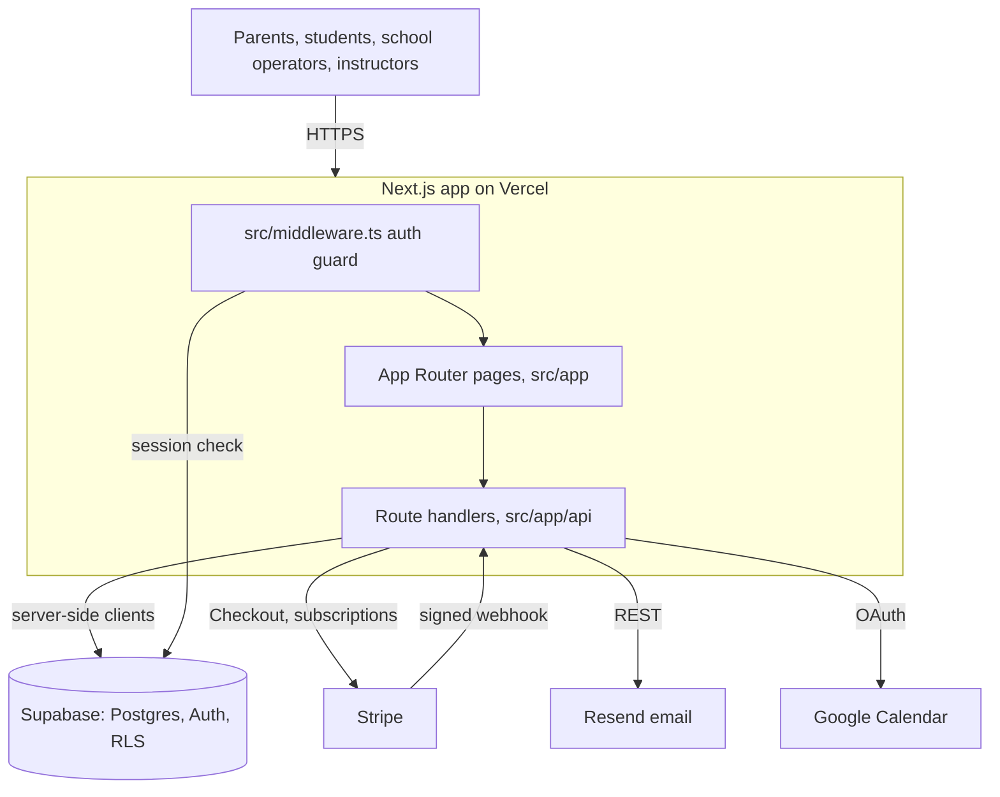

# Roadsmith architecture

Roadsmith is a Next.js application with a single product repository and explicit integration boundaries.

## Runtime boundaries

- `src/app/` contains App Router pages, layouts, and API handlers.
- `src/components/` contains shared UI and domain-facing components.
- `src/lib/` contains domain logic, validation, Supabase clients, payment helpers, email helpers, and security utilities.
- `supabase/` contains the newer migration/function boundary; legacy migration history under `src/lib/migrations/` is retained for reconciliation and must not be treated as automatically applied.
- `tests/` contains unit and integration-oriented checks; `e2e/` contains browser or HTTP smoke checks.
- `scripts/` contains repository verification and product maintenance scripts only.

## Product flow

The intended workflow is parent-first intake → travel-aware scheduling proposal → operator approval → payment → booking → reminders and rescheduling → post-lesson notes. The public booking surface must not imply that an automated proposal is an approved booking until the operator and payment states are explicit.

## Integration boundaries

- Supabase stores tenant-scoped product data and enforces access through authenticated server flows and RLS.
- Stripe handles deposits and subscription billing. Webhooks must verify signatures and remain idempotent.
- Resend handles transactional email. Provider errors must not expose credentials or internal details to callers.
- Vercel hosts the Next.js application. The canonical project and hostname are documented as a deployment decision, not inferred from a successful local build.

## Review and release constraints

Customer data, service-role access, payment secrets, provider state, internal
agent operations, and production-only routes are outside the public review
surface. See `SECURITY.md` and `docs/PUBLIC-RELEASE-BOUNDARY.md` for the
documented release boundary and unresolved verification items.

## System diagram

## Code layout

| Path | Contents |
| --- | --- |
| `src/app/` | Pages: marketing (`/`, `/pricing`, `/faq`, `/contact`, `/legal`), booking (`/book`, `/school/[slug]`), `/school-admin`, `/instructor`, `/onboarding`, `/demo`, auth pages |
| `src/app/api/` | Route handlers: bookings, sessions, slots, students, instructors, schools, school-admin, import, notify, reminders, checkout, stripe, webhooks, demo, auth |
| `src/components/` | UI grouped by surface: `admin`, `auth`, `dashboard`, `marketing`, `onboarding`, `ui` |
| `src/lib/` | Domain logic: Supabase clients, compliance, school-admin, onboarding, workflow watchdog, email, security, validation, booking lifecycle |
| `src/middleware.ts` | Guards `/school-admin` and `/instructor` routes |
| `supabase/` | Migrations, edge function, SQL scripts (see [DATABASE.md](DATABASE.md)) |
| `tests/unit/`, `e2e/` | Node unit tests and Playwright smoke tests (see [TESTING.md](TESTING.md)) |
| `scripts/` | Verification and maintenance scripts |

## Adding an API route

1. Create `src/app/api/<area>/route.ts` (or `<area>/[id]/route.ts` for a dynamic segment) and export one
   async function per HTTP method (`GET`, `POST`, ...). Group it with the existing area in
   [REPOSITORY-MAP.md](REPOSITORY-MAP.md) when one fits.
2. Parse and validate the body server-side; return `NextResponse.json({ error }, { status: 400 })` on bad
   input and a generic message on failure. Keep pure validation in `src/lib/` so it can be unit tested.
   `src/app/api/contact/route.ts` with `src/lib/contact.ts` is the smallest complete example.
3. Authenticated school-admin routes call `resolveSchoolAdminContext(request)` from
   `src/lib/school-admin/auth.ts` and return 401 when it is null. Scope every query by that context's
   school id. Use the server Supabase client in `src/lib/supabase/server.ts`; check columns in
   `ACTUAL_SCHEMA.md` first.
4. New `process.env.X` reads go into `.env.example` in the same PR.
5. Add a unit test in `tests/unit/<name>.test.mjs` for the `src/lib/` logic (see `tests/unit/contact.test.mjs`),
   plus authorized, unauthorized and cross-school cases for tenant data. Then run the checks in
   [TESTING.md](TESTING.md).
