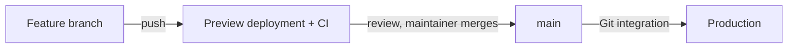

# Deployment

Roadsmith is deployed on Vercel using its Git integration. Configure environment variables in the hosting
dashboard using the names in [`.env.example`](../.env.example); values never go in the repository.

- Every pushed branch gets a preview deployment linked from the pull request.
- Merging to `main` deploys production, so only the maintainer merges.
- Build command: `npm run build` (see `vercel.json`).
- Rollback uses the host's instant rollback to the previous production deployment.
- After a deploy, load `/`, `/pricing`, and `/demo/operator-review` and confirm they render.
