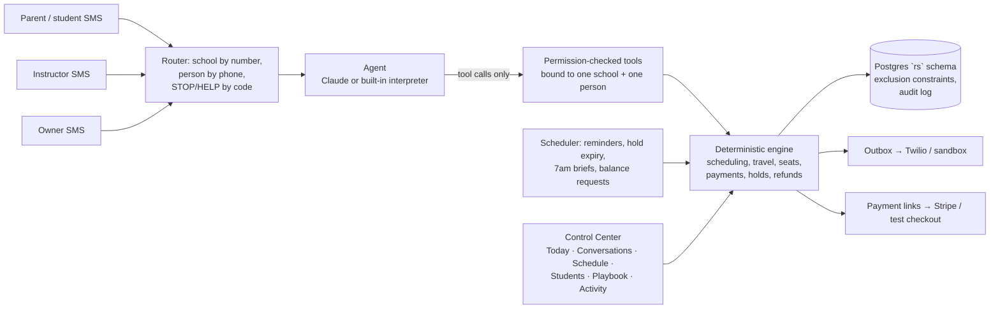

# Roadsmith OS: the text-message operating system for driving schools

Roadsmith OS is the product's core. It works like a front-desk employee that people text. Parents, students, instructors and the owner text the school's number in plain English. Roadsmith answers, books, collects payments, reminds people and coordinates instructors. Owners use a Control Center to see results and make the decisions it won't make alone.

This doc covers how it works, what is verified, and what a real school needs before going live. The founder's notebook is the reference for intent: give the school the result, not another tool to run.

## The idea in one diagram

**AI handles the conversation. Ordinary software handles anything that has to be exact**, such as availability, double-booking, money, permissions and records. The model can only act through tools, and every tool is bound to one school and one person before the model sees the conversation.

## Where it lives

| Path | What it is |
| --- | --- |
| `supabase/migrations/20261124000000_roadsmith_os.sql` | Schema `rs`: schools, staff, hours, time off, contacts, students, services, courses, enrollments, lessons, payments, conversations, messages, outbox, inbox, jobs, audit log. RLS is on with no policies, so only server code can read it. |
| `src/lib/os/db.ts` | Postgres access. The sandbox uses PGlite (Postgres compiled to WASM, stored under `.roadsmith/`). Production uses `pg` with `DATABASE_URL`. Both run the same SQL. |
| `src/lib/os/scheduling.ts`, `travel.ts` | Travel-aware slot finding and re-validation. |
| `src/lib/os/bookings.ts` | Students, lesson holds and bookings, moves, cancellations, completion, course seats, balances, and payment outcomes. |
| `src/lib/os/payments.ts`, `actions.ts` | Payment requests (token links) and approved actions (refunds, moves, drive plans). |
| `src/lib/os/cohort.ts` | The notebook's "agent creates the drive-time schedule": plans a whole cohort's behind-the-wheel lessons, grouped by pickup location. |
| `src/lib/os/automations.ts`, `jobs.ts` | Durable jobs: hold expiry, lesson and class reminders, balance requests, 7am instructor and owner briefs. Respects quiet hours. |
| `src/lib/os/messaging.ts` | Conversations and the transactional outbox. Texts are recorded in the same transaction as the change and delivered after commit. |
| `src/lib/os/inbox.ts` | Approvals, escalations and alerts: everything a human has to decide. |
| `src/lib/os/agent/` | `router.ts` (entry point), `tools.ts` (the permission boundary), `claude.ts` (Messages API loop), `interpreter.ts` (no-key fallback), `grounding.ts` (reply checks), `prompt.ts`. |
| `src/lib/os/playbook.ts` | The school's knowledge, policies and autonomy settings (zod-validated). |
| `src/app/app/` | Control Center pages. |
| `src/app/sandbox/`, `src/app/pay/[token]/` | The sandbox phone and the payment page. |
| `src/app/api/os/` | Route handlers: Twilio and Stripe webhooks, cron, Control Center actions, sandbox controls. |

## Safety model

Each guarantee is enforced in code, and the column on the right says where.

| Guarantee | Where it is enforced |
| --- | --- |
| No instructor or student is double-booked. | Postgres `EXCLUDE USING gist` constraints on `rs.lessons` (instructor, and student, by time range), plus engine checks. |
| A time is offered only if it is truly possible. | `findSlots` checks working hours, time off, classes, closed dates, minimum notice, the student's other commitments, and drive time from the previous stop and to the next one. `checkSlot` re-runs all of this right before any write. |
| The agent can't invent a bookable time. | `book_lesson` and `reschedule_lesson` accept only an option letter that `find_lesson_times` returned in this conversation in the last 2 hours. |
| The agent can't invent facts in a reply. | `grounding.ts` checks every clock time, dollar amount and link in a Claude reply against this turn's tool results and the playbook. One correction retry is allowed; after that the message goes to the owner. |
| "Paid" means paid. | Lessons and seats stay `held` until a verified provider event arrives (the Stripe webhook signature, or the sandbox checkout). Events are idempotent on the event id. A payment that arrives after a hold expired goes to the owner as urgent and is never silently booked. |
| People only see their own records. | The router identifies the texter by phone number within the school that was texted. Customer tools resolve students through `guardian_contact_id`/`student_contact_id`. Claiming an existing student by name and birth date creates an escalation for the office to verify; it does not link the record. |
| Tenant isolation. | The school comes from the number that was texted, or from the signed session's staff row. It is never taken from request input. All queries are scoped by `school_id`. |
| Roles. | `toolsFor(audience)`: customers get booking tools, instructors get schedule tools and no payment data, owners get everything. Only owners and admins can sign in to the Control Center. |
| Autonomy limits. | `playbook.autonomy`: each action is set to handle it, ask me first, or send to me. Refunds and late changes default to ask me first. |
| Messaging compliance. | STOP, START and HELP are handled by code before the agent runs. Opted-out numbers are suppressed in the outbox. The first reply discloses that the assistant is automated. Automated texts wait out quiet hours (default 9pm–8am). |
| Audit. | Every change writes to `rs.audit_log` with the actor (agent, staff, system, provider or contact). Agent runs are logged with tool calls, grounding result, tokens and latency in `rs.agent_runs`. |

Sensitive topics always go to the owner. These include medical and safety questions, accidents, complaints, discounts, and legal or paperwork questions. The built-in interpreter enforces this with patterns; the Claude prompt tells the model to call `escalate_to_owner`.

## The two conversation engines

- **Claude** (when `ANTHROPIC_API_KEY` is set). It runs a manual tool-use loop on the Messages API with `claude-opus-5-5` (configurable) at low effort for SMS latency, server-side refusal fallback, and a prompt-cached system prompt per school.
  - We host the loop ourselves rather than using a managed agent. Every tool is a database operation that has to run inside our tenant and permission boundary, and the grounding check has to sit between the model and the customer.
- **Built-in interpreter** (no key). Deterministic intent parsing with conversation state: enrollment, registration, booking, rescheduling, cancellation, payments, FAQs, instructor commands, and owner briefs and approvals. It is narrower than the model and escalates what it doesn't understand. Both engines call the same tools, so the safety properties are identical.

## What the owner sees

- **Today:** what needs a decision (approve, decline, or reply), what was handled, each instructor's stops in order, money collected, balances due, class fill, and cohorts that still need drive times.
- **Conversations:** every thread, which tools ran for each reply, take over and hand back, and texting as the school.
- **Schedule:** a week by instructor, lesson actions (done, no-show, cancel), and classes with drive-plan drafting.
- **Students:** progress, missing details, balances, history.
- **Playbook:** answers, policies, autonomy, texting rules, connection status.
- **Activity:** the audit trail.

Owners can also do most of this by text: "how are we doing", "inbox", "approve 1", "plan drives", "how is Emma Carter", and "tell Emma Carter's family we're closed Friday".

## Verification status

Everything below was run in this repository against the local sandbox. See [TESTING.md](TESTING.md).

| Area | Status |
| --- | --- |
| Engine: scheduling, travel feasibility, holidays, time off, overlaps, seats, holds, payment outcomes, refunds, drive plans, quiet hours | Unit-tested (`tests/unit/os-engine.test.mjs`) |
| Agent: booking only from offered options, cross-family and cross-school isolation, instructor permission limits, STOP/START/HELP, escalation of sensitive messages, owner approval by text, grounding, the Claude loop with a fake client | Unit-tested (`tests/unit/os-agent.test.mjs`) |
| Parent inquiry → registration → booking → declined card → payment → confirmation → owner view | Browser-tested (`e2e/os-journey.spec.ts`) and checked by hand |
| Drive-plan drafting and approval, autonomy change, approval-gated booking, conversation takeover, mobile layout | Checked by hand in the browser |
| Claude engine against the live API | **Not verified here** (no API key in this environment). The loop is tested with a fake client. |
| Twilio inbound and outbound, Stripe Checkout and webhook, Supabase Auth sign-in, `DATABASE_URL` Postgres backend | **Implemented, not verified** (they need accounts). Signature validation is unit-tested. |

## Before onboarding a real school

1. **Database:** a Supabase project with this migration applied (`supabase db push` or the SQL editor), plus `DATABASE_URL` and `ROADSMITH_SESSION_SECRET`. Create the school, staff, services, hours and playbook. There is no self-serve onboarding yet, so this is a setup step done by Roadsmith.
2. **Texting:** a Twilio number with the inbound webhook pointed at `/api/os/sms/twilio` and `TWILIO_WEBHOOK_URL` set to that exact URL. US numbers need A2P 10DLC brand and campaign registration (unregistered long-code SMS is blocked). In Canada, check CASL consent and identification.
3. **Payments:** Stripe keys and a webhook to `/api/os/stripe/webhook`. Use test mode first; live keys also require `ROADSMITH_ALLOW_LIVE_PAYMENTS=1`.
4. **AI:** `ANTHROPIC_API_KEY`. Run the sandbox journeys with it and read the Activity log before going live.
5. **Scheduler:** call `GET /api/os/cron` with `Authorization: Bearer $CRON_SECRET` every 5 minutes. On Vercel, sub-daily cron needs a paid plan; any external scheduler also works.
6. **Owner sign-in:** Supabase Auth email sign-in. The staff email must match `rs.staff.email` with role owner or admin.
7. **Legal and policy review:** privacy policy and terms for texting minors' families, the consent language on the school's website, data retention, and the school's state or provincial rules (hour certificates and forms are not generated by Roadsmith OS). See [research/INDUSTRY-RESEARCH.md](research/INDUSTRY-RESEARCH.md).
8. **Production hardening still open:** a maps provider for real drive times (today's estimate uses distance by ZIP zone), self-serve editing of services and prices, staff management UI, rate limiting on public endpoints, error monitoring, and a load test of the Postgres path.

## Known limits

- Drive times are estimates. Addresses whose ZIP isn't in a service zone get a 30-minute buffer, so the engine stays conservative rather than optimistic.
- The interpreter understands common phrasings only. For example, it reads "next week" and weekday names but not arbitrary dates like "Dec 9". Use Claude for natural conversation.
- One lesson per student per day, and a weekly maximum from the playbook.
- A Stripe refund is issued from inside the approval transaction. If the database write then fails, the refund has already happened, so reconcile it in Stripe. This is rare, but noted.
